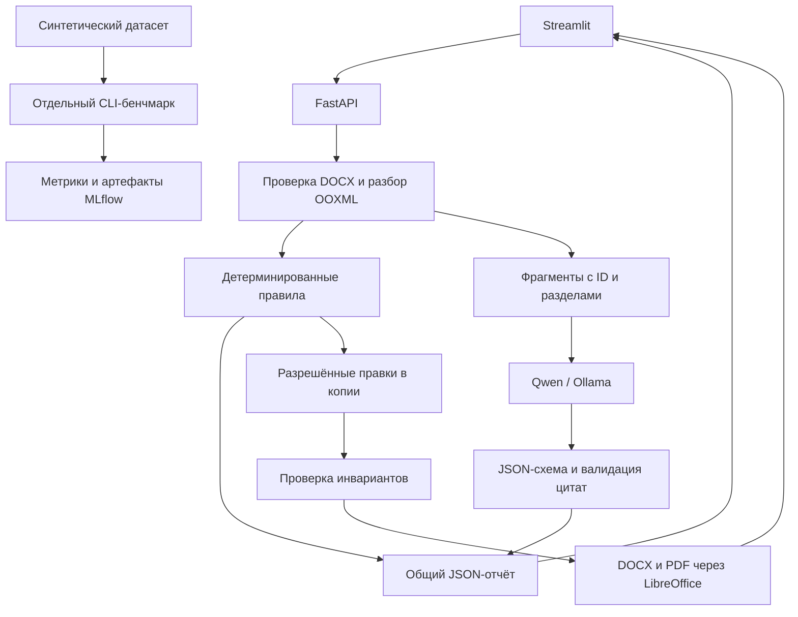

# Document AI Inspector

[](https://github.com/aleksandrchepinoga18/document-ai-inspector/actions/workflows/ci.yml)

**Учебный ML/LLM-проект для интеллектуальной проверки и безопасного исправления корпоративных DOCX-документов.**

Система объединяет детерминированные правила оформления, поиск между разделами смысловых противоречий с помощью LLM и адресное редактирование OOXML. Пользователь получает объяснимые замечания с привязкой к исходным фрагментам, отдельную исправленную копию, JSON-отчёт и PDF для просмотра.

Проект демонстрирует полный цикл работы с LLM: интеграцию локальной модели, структурированный вывод, проверку цитат, воспроизводимую оценку, анализ ошибок и учёт экспериментов в MLflow. Это MVP; результаты на синтетических данных не являются подтверждением качества на реальных корпоративных документах.

## Бизнес-задача

При согласовании регламентов, договоров и внутренних инструкций приходится проверять два разных класса ошибок: несоблюдение требований к оформлению и несовместимые утверждения в разных разделах. Например, срок исполнения одного договора может составлять 10 дней во введении и 30 дней в заключении.

Document AI Inspector помогает выделить такие места для ручной проверки и автоматизировать разрешённые изменения оформления. Смысловые факты, числа и формулировки автоматически не заменяются. Исходный документ сохраняется отдельно и контролируется по SHA-256.

## Возможности

| Возможность | Реализация |
|---|---|
| Проверка оформления | Версионированный JSON-профиль: шрифт, размер, выравнивание, отступ первой строки, заголовки, обязательные разделы и подписи таблиц |
| Смысловая проверка | Локальная Qwen через Ollama; поиск несовместимых утверждений в разных разделах |
| Проверка ответа LLM | Pydantic-схема, существование ID, ссылки на разные разделы и дословное совпадение цитат с исходными фрагментами |
| Безопасные правки | Точечное изменение разрешённого размера шрифта в поддерживаемых элементах; отдельная копия и журнал правок |
| Контроль DOCX | Проверка неизменности текста, таблиц, медиа, формул, связей и защищённых OOXML-частей; отказ в публикации правок при нарушении инвариантов |
| PDF | Headless LibreOffice с timeout и изоляцией временного профиля; проверка PDF через PyMuPDF |
| Отчёты | JSON по документу; JSON/CSV по кейсам бенчмарка, параметры и метрики в MLflow |
| Интерфейс и API | Streamlit обращается к настоящему FastAPI: загрузка, профиль, провайдер, замечания и скачивание результатов |
| Автономный режим | Правила и безопасное редактирование работают без LLM, облачных ключей и доступного MLflow |

Дополнительно реализованы opt-in адаптер Yandex AI Studio и OpenAI-compatible адаптер для существующего vLLM-сервера. Облачные вызовы разрешены только для синтетических данных с явным подтверждением. Промышленное развёртывание vLLM в проект не входит.

## Архитектура и технологии



Проверка документа и LLM-анализ выполняются в отдельных worker-процессах с ограничением времени. Модель получает текстовые фрагменты с воспроизводимыми ID и не имеет доступа к редактированию DOCX. Формальные и смысловые замечания имеют общий контракт, но разные источники: `rule` и `llm`.

| Компонент | Технологии |
|---|---|
| Backend и контракты | Python 3.12, FastAPI, Pydantic v2, pydantic-settings |
| DOCX | python-docx, lxml; собственное извлечение и mapping ID → OOXML-узел |
| LLM | OpenAI Python SDK, Ollama / Qwen 2.5 7B, адаптеры Yandex AI Studio и vLLM |
| UI | Streamlit, HTTPX |
| PDF | LibreOffice CLI, PyMuPDF |
| Evaluation | Авторский синтетический датасет, event-level matching, MLflow Tracking |
| Инфраструктура и тесты | Docker Compose, SQLite, pytest, pytest-cov, Streamlit AppTest |

Текущий парсер использует python-docx/lxml; Docling не подключён. Python-зависимости закреплены в `requirements.txt` с SHA-256, установка в образе выполняется через `pip --require-hashes`. Базовый образ — Python 3.12.12; пакеты Debian могут обновляться, поэтому побайтовая воспроизводимость Docker-образа не заявляется.

```text
backend/
  api/          # HTTP-маршруты и ограничения загрузки
  core/         # конфигурация и Pydantic-контракты
  documents/    # security, parser, profiles, rules, editor, validator, renderer
  llm/          # провайдеры, prompt, grounding и worker
  pipeline/     # оркестрация проверки, хранение и выдача артефактов
frontend/       # Streamlit и HTTP-клиент FastAPI
evaluation/     # датасет, benchmark, metrics, MLflow и офлайн-анализ
samples/        # генератор синтетических DOCX
tests/          # unit/integration и синтетические контрольные данные
docs/           # финальная приёмка и сценарий демонстрации
```

## Quick Start

Основная среда запуска — **Windows 10/11, Git Bash и Docker Desktop с Linux containers**. Нужны доступ к Docker Hub/PyPI/Debian repositories для первой сборки и свободные порты `18000`, `8501`, `5000`. Python на хосте для Docker-запуска не требуется.

### 1. Подготовить настройки и запустить сервисы

Из каталога клонированного репозитория:

```bash
test -f .env || cp .env.example .env
docker version
docker compose config --quiet
docker compose up -d --build
docker compose ps
curl --fail http://localhost:18000/health
```

`.env.example` содержит имена настроек и безопасные значения по умолчанию; собственные настройки и ключи храните в `.env`. Не добавляйте `.env` в Git. Наличие ключа не запускает модель: по умолчанию UI работает в режиме «Без LLM».

Ожидается `{"status":"ok"}` от API и healthy-состояние сервисов `api`, `ui`, `mlflow`. Первый запуск MLflow может потребовать дополнительного времени.

| Сервис | Адрес на хосте |
|---|---|
| Streamlit | http://localhost:8501 |
| FastAPI / OpenAPI | http://localhost:18000/docs |
| API health | http://localhost:18000/health |
| MLflow | http://localhost:5000 |

Внутри Compose UI использует `http://api:8000`, Tracking URI — `http://mlflow:5000`. На хосте API опубликован на **18000**, а не на 8000. Все опубликованные порты привязаны к `127.0.0.1`.

### 2. Подключить локальную Ollama

Ollama работает отдельно на Windows-хосте. Для воспроизведения используемого baseline загрузите локальную модель и запустите Ollama:

```bash
ollama pull qwen2.5:7b-instruct
ollama list
```

В `.env` укажите точное имя установленной модели. Для этой конфигурации:

```dotenv
OLLAMA_BASE_URL=http://host.docker.internal:11434/v1
OLLAMA_MODEL=qwen2.5:7b-instruct
LLM_TIMEOUT_SECONDS=120
LLM_TOTAL_TIMEOUT_SECONDS=120
PROCESSING_TIMEOUT_SECONDS=240
```

Увеличенный общий timeout оставляет время на анализ и PDF. После изменения настроек пересоздайте сервисы:

```bash
docker compose up -d --build
```

В UI выберите Ollama и нажмите «Проверить документ». Облачные алиасы Ollama не допускаются. Без установленной модели можно пользоваться формальными проверками и выполнять обычные тесты.

### 3. Дополнительные провайдеры

Для Yandex AI Studio в `.env` предусмотрены `YANDEX_BASE_URL`, `YANDEX_FOLDER_ID`, `YANDEX_MODEL` и `YANDEX_API_KEY`. URI модели задаётся явно; поддерживается шаблон `gpt://{folder_id}/<имя-модели>/<версия>`. В UI требуются два подтверждения: синтетические данные и разрешение платного вызова. В API это `allow_cloud=true` и `synthetic_data=true`.

Для уже развёрнутого vLLM задаются `VLLM_BASE_URL`, `VLLM_MODEL` и при необходимости `VLLM_API_KEY`. Наличие адаптера не означает, что в проекте развёрнут или проверен промышленный GPU-инференс.

## Пример пользовательского сценария

1. Откройте Streamlit и выберите «Синтетический пример» → «Ошибки оформления».
2. Выберите реальный профиль `default` v1.0.0, оставьте «Без LLM», включите разрешённые правки и PDF.
3. Нажмите проверку. Для этого примера ожидаются четыре замечания: размер шрифта исправляется с 10 до 14 pt, остальные три требуют ручной проверки.
4. Изучите источник, место в документе, цитату, actual/expected и журнал правок. Скачайте исходник, исправленный DOCX, JSON-отчёт и PDF.
5. Сравните контрольную сумму исходника с сохранённым до проверки примером и визуально проверьте вёрстку PDF.
6. Для смыслового анализа выберите «Смысловое противоречие» и Ollama. В разделах документа указаны сроки 10 и 30 дней. Система покажет принятые замечания либо фактическую причину отказа анализа; обнаружение ошибки не гарантируется.

Можно загрузить собственный синтетический DOCX вместо встроенного примера. Смена документа или параметров убирает предыдущий результат; обычный rerun страницы не повторяет POST. При недоступной LLM формальные результаты сохраняются. При провале инвариантов исправленная копия не публикуется.

### API

| Метод и маршрут | Назначение |
|---|---|
| `GET /health` | Статус сервиса |
| `GET /documents/options` | Доступные профили, лимит файла и timeout |
| `POST /documents/check` | Multipart DOCX, параметры проверки и полный отчёт с UUID |
| `GET /documents/{id}/report` | Сохранённый JSON-отчёт |
| `GET /documents/{id}/download` | DOCX результата при разрешённой выдаче |
| `GET /documents/{id}/download?original=true` | Исходный DOCX |
| `GET /documents/{id}/preview` | PDF при успешной конвертации |

Пример запроса из Git Bash, если синтетический `format_errors.docx` уже сохранён в текущем каталоге:

```bash
curl --fail-with-body \
  -F 'file=@format_errors.docx;type=application/vnd.openxmlformats-officedocument.wordprocessingml.document' \
  -F 'profile=default' -F 'provider=none' -F 'use_llm=false' \
  -F 'auto_fix=true' -F 'render_pdf=true' \
  http://localhost:18000/documents/check
```

Успешный POST возвращает HTTP 201. Подробности контрактов — в [техническом задании](TECHNICAL_SPEC.md), ручной сценарий — в [финальной приёмке](docs/FINAL_ACCEPTANCE.md).

## Evaluation

Набор [synthetic-v1.json](evaluation/datasets/synthetic-v1.json) содержит **24 отдельных синтетических кейса** с авторской разметкой: 12 с противоречиями, 8 без противоречий и 4 неоднозначных. Разметка задана независимо от ответов модели; внешнего экспертного аудита не было.

Оценка проводится на смысловых событиях отдельно от формальных правил. Сопоставление учитывает тип, ID фрагментов и подтверждающие цитаты; используется максимальное соответствие «один к одному». TP/FP/FN суммируются по 20 однозначным кейсам. Четыре неоднозначных учитываются отдельно. Нулевой знаменатель даёт 0.

### Baseline: Qwen 2.5 7B Instruct через Ollama

Для сохранённого запуска `qwen2.5:7b-instruct`, temperature=0, max_tokens=1024:

| Оценка тех же сохранённых ответов | TP | FP | FN | Precision | Recall | F1 |
|---|---:|---:|---:|---:|---:|---:|
| Исходный matcher v1 | 8 | 4 | 4 | 0.6667 | 0.6667 | 0.6667 |
| Офлайн-пересчёт matcher v2 | 9 | 3 | 3 | 0.75 | 0.75 | **0.75** |

**F1=0.75 — результат исправления оценки сохранённых ответов, а не улучшения модели или нового запуска LLM.** Matcher v1 ошибочно не сопоставлял корректные цитаты без конечных точек с эталоном. В v2 изменилось только сопоставление `positive-storage`; ground truth, baseline prompt и ответы модели остались прежними. Строгая дословная проверка цитат валидатором не ослаблялась.

В исходном run все 24 ответа соответствовали JSON-схеме, но пять не прошли проверку цитат. Три смысловых FP связаны с неверной трактовкой разных этапов, эквивалентных сумм и общего правила с частным случаем. Поэтому F1 необходимо читать вместе со счётчиками валидации: отказы на отрицательных документах не увеличивают event-level FP. Подробнее — [анализ ошибок](evaluation/reports/ollama-stage5-analysis.md).

MLflow логирует провайдера и модель, версии и хеши набора/промпта, matcher, настройки генерации, TP/FP/FN, precision/recall/F1, JSON/reference-valid rates, mean/p95 latency и ошибки. Артефакты — `summary.json`, `cases.json`, `cases.csv`, `manifest.json`; ключи и пользовательские DOCX в них не включаются. Обычная проверка документа не зависит от MLflow.

### Команды бенчмарка

Проверка инфраструктуры без реальной модели:

```bash
docker compose exec api python -m evaluation.benchmark --dry-run
# Без доступного Tracking Server:
docker compose exec api python -m evaluation.benchmark --dry-run --no-mlflow
```

Mock-run отделён в эксперимент `semantic-benchmark-mock` и явно помечен. Его TP=0, FP=0, FN=12 не являются метриками реальной модели.

Реальный бенчмарк запускается вручную после настройки Ollama:

```bash
docker compose exec api python -m evaluation.benchmark --provider ollama
```

Для платного Yandex требуется отдельный явный запуск:

```bash
docker compose exec api python -m evaluation.benchmark --provider yandex --allow-paid
```

При `LLM_MAX_RETRIES=0` обрабатываются 24 кейса без повторных попыток. Сравнивать модели нужно при одинаковых версиях данных, промпта, matcher и параметрах генерации. Температура 0 не гарантирует побитовую детерминированность, а имя модели может быть изменяемым alias.

Офлайн-пересчёт синтетической контрольной копии baseline из репозитория без LLM и MLflow:

```bash
AUDIT_FILE="results/benchmark-analysis/audit-$(date +%Y%m%d-%H%M%S)-$RANDOM.json"
MSYS_NO_PATHCONV=1 docker compose exec api python -m evaluation.analyze_run \
  --run-dir tests/fixtures/ollama-stage5-baseline \
  --output "/app/$AUDIT_FILE"
```

Ожидается отдельный JSON с baseline 8/4/4, пересчётом 9/3/3 и единственным изменённым кейсом `positive-storage`. Контрольные данные не перезаписываются. Правила метрик, знаменатели, коды завершения CLI и формат артефактов описаны в [evaluation/README.md](evaluation/README.md).

## Тестирование

По результатам финальной локальной проверки **10.11.2026: 199 успешных тестов, 3 external-теста исключены, покрытие backend — 88%**. Это зафиксированный результат проверки, а не автоматически обновляемый статус GitHub CI.

```bash
docker compose exec api python -m pytest -v
docker compose exec api python -m pytest --cov=backend --cov-report=term-missing
```

Проверяются parser/rules/editor, OOXML-инварианты, негативные ZIP/XML, метрики и matching, CLI, HTTP API, сохранение исходника и Streamlit → клиент → FastAPI → worker → скачивание. В UI-тестах используется ASGI transport. В отдельных явно обозначенных тестах LLM и конвертация LibreOffice заменены контролируемыми ответами; это не подтверждает работу реальных моделей или настоящую браузерную загрузку файла.

Обычный pytest не вызывает реальные LLM и не требует облачных ключей. Сетевые интеграционные тесты маркированы `external` и требуют явного включения. Проверка Linux-образа, настоящего PDF и UI в браузере входит в [чек-лист ручной приёмки](docs/FINAL_ACCEPTANCE.md). При подготовке CI локально повторён запуск с `--cov-fail-under=80`: **199 passed, 3 deselected, покрытие 88.34%**. GitHub-hosted runner и публикация образа будут проверены отдельно.

## CI/CD: GitHub Actions и GHCR

Два workflow автоматизируют проверку и доставку образа. **CD здесь означает
публикацию в GitHub Container Registry, а не развёртывание на сервере.**

### Автоматические проверки

[`ci.yml`](.github/workflows/ci.yml) запускается при `push` в `main` и для Pull Request
(также при обновлении PR):

1. Ubuntu 24.04, Python 3.12, установка закреплённых зависимостей с `--require-hashes`
   и проверка совместимости через `pip check`.
2. Все обычные pytest с существующим `-m "not external"`, включая UI/API,
   mock-провайдеров и MLflow с временной SQLite. Порог покрытия backend — **80%**;
   более низкое покрытие завершает job с ошибкой.
3. После тестов — проверка Compose и сборка существующего Dockerfile без публикации.
4. В собранном образе — существующий тест настоящего LibreOffice PDF export
   с `--network none`. Его маркер `external` включается адресно; два теста реальных
   LLM не запускаются.

Отдельные Ollama, Yandex, vLLM и MLflow Server для CI не требуются. Секреты моделей
не передаются; реальные LLM-тесты дополнительно выключены переменными запуска.
Весь CI имеет только `contents: read`.

Логи и результаты доступны во вкладке
[Actions](https://github.com/aleksandrchepinoga18/document-ai-inspector/actions).
Бейдж сверху отражает CI ветки `main`; исторические 199 тестов и 88% выше описывают
локальную финальную проверку, а не результат ещё не выполненного GitHub workflow.

### Публикация после CI

[`publish.yml`](.github/workflows/publish.yml) получает `workflow_run` после завершения
`CI`. Публикация разрешена только при `conclusion=success`, исходном событии `push`,
ветке `main` и совпадении репозитория. При ошибке/отмене CI или для PR job публикации
не выполняется. Проверяется успех всего CI, включая Docker/PDF job.

CD делает checkout именно `head_sha` успешного CI, а не произвольного текущего HEAD;
артефакты и build-кэши из PR не используются. Для входа в GHCR используется встроенный
`GITHUB_TOKEN`. Только publish job получает `contents: read` и `packages: write`;
персональный токен или секреты Docker Hub для него не нужны.

Образ: `ghcr.io/<owner>/document-ai-inspector`, где owner автоматически приводится
к нижнему регистру. Публикуются `latest` и `sha-<полный commit SHA>`, платформа —
`linux/amd64`. `latest` указывает на последнюю публикацию; для фиксированной версии
используйте SHA-тег или digest. Образ содержит приложение и LibreOffice, но не веса LLM.

Условия запуска и публикации основаны на документации
[workflow_run](https://docs.github.com/en/actions/reference/workflows-and-actions/events-that-trigger-workflows#workflow_run)
и [GitHub Container Registry](https://docs.github.com/en/packages/working-with-a-github-packages-registry/working-with-the-container-registry).

### Настройки GitHub

1. Основная ветка репозитория — `main`; оба workflow должны находиться в ней.
   `workflow_run` требует наличия принимающего workflow в default branch.
2. В **Settings → Actions → General** разрешите GitHub Actions и используемые
   actions из `actions/*` и `docker/*`. Ограничения организации должны разрешать
   запрошенный `packages: write`; выдавать глобальные права записи всем jobs не нужно.
3. При защите `main` добавьте обязательные CI checks **Tests and coverage** и
   **Docker build and PDF smoke test**. Publish job не делайте обязательной проверкой PR.
4. После первой публикации найдите пакет в **Packages**. Для анонимного `docker pull`
   явно установите видимость **Public** в настройках пакета: публичность репозитория
   сама по себе не делает новый пакет публичным. Если пакет уже существовал,
   проверьте доступ этого репозитория в **Manage Actions access**.
5. Secrets Ollama/Yandex/vLLM в GitHub не добавляйте. `GITHUB_TOKEN` создаётся
   автоматически на время job.

### Локальная проверка и отправка изменений из Git Bash

Эквивалентные проверки в Linux-контейнере, без вызова моделей:

```bash
docker compose config --quiet
docker build --tag document-ai-inspector:ci .
docker run --rm --network none document-ai-inspector:ci \
  python -m pytest -v -m 'not external' \
  --cov=backend --cov-report=term-missing --cov-fail-under=80
docker run --rm --network none document-ai-inspector:ci \
  python -m pytest -v -m external \
  tests/integration/test_document_export.py::test_real_libreoffice_pdf_export
```

После проверки отправку выполняет владелец репозитория. Если прямой push в `main`
разрешён, последовательность для этих изменений:

```bash
git add .github/workflows/ci.yml .github/workflows/publish.yml README.md
git commit -m "ci: test project and publish successful main builds to GHCR"
git push origin main
```

При защищённой `main` отправьте рабочую ветку, создайте PR и выполните merge после
CI. PR только проверяется; публикацию запустит успешный CI нового push в `main`.
Ручного обхода CI через `workflow_dispatch` у publish workflow нет.

### Получение готового образа

После первого успешного Publish и настройки видимости Public:

```bash
IMAGE=ghcr.io/aleksandrchepinoga18/document-ai-inspector:latest
docker pull "$IMAGE"
```

Чтобы использовать этот общий образ для API/UI/MLflow с существующим Compose,
вместо локальной сборки:

```bash
docker tag "$IMAGE" document-ai-inspector:stage6
docker compose up -d --no-build
docker compose ps
```

`.env` по-прежнему настраивается локально по Quick Start. Для private-пакета
потребуется отдельная локальная авторизация с правом чтения Packages; токен не
добавляется в репозиторий. В форке замените owner в командах и URL бейджа.

GitHub Actions и загрузка в GHCR будут проверены после отправки этих файлов на GitHub;
наличие конфигурации не означает, что образ уже опубликован.

## Хранение, диагностика и остановка

Исходники, отчёты, исправленные копии и PDF хранятся в volume `documents_data` (`/app/results`). MLflow использует `mlflow_data`: SQLite и локальные артефакты, обслуживаемые через HTTP. Обычный `docker compose down` сохраняет оба volume. Автоматической очистки документов нет.

Диагностика сервисов:

```bash
docker version
docker context show
docker compose config --quiet
docker compose ps -a
docker compose logs --tail=100 api ui mlflow
curl --fail http://localhost:18000/health
curl --fail http://localhost:5000/health
docker compose exec api libreoffice --version
```

Если Docker не показывает Server, проверьте Docker Desktop и Linux containers. При занятом порте освободите 18000/8501/5000. Если остался старый интерфейс, пересоберите сервисы. При ошибке Ollama проверьте имя локальной модели, адрес из контейнера и timeout. При ошибке PDF документ и JSON могут оставаться доступными; при проблемах SQLite проверьте логи и права volume, не удаляя данные.

```bash
docker compose logs -f api
# Ctrl+C завершает просмотр логов
docker compose down
```

Не используйте `down -v`, если нужны сохранённые документы и эксперименты. `.gitignore` исключает секреты, документы, runtime-результаты, окружения, кэши, веса моделей и временные файлы. Синтетическая разметка и контрольные JSON остаются в Git. `.dockerignore` и явный список COPY ограничивают содержимое образа. Не публикуйте `.env` и полный вывод `docker compose config`.

## Ограничения MVP и дальнейшее развитие

Текущие ограничения:

- Поддерживаются DOCX и ограниченное подмножество OOXML. Поля, формулы, сноски, track changes, сложные таблицы и другие неподдерживаемые объекты отмечаются; произвольное безопасное редактирование не заявляется.
- Смысловой анализ работает по поддерживаемым фрагментам основного текста и разным разделам. Результат LLM требует ручной проверки; существование цитаты не доказывает логическую правильность замечания.
- Неопределимые свойства оформления не считаются достоверной ошибкой. Демонстрационный профиль `default` не является сертификацией соответствия ГОСТ.
- Автоправки ограничены разрешённым размером шрифта; они не меняют факты, числа, содержимое таблиц и формулы. PDF и число его страниц не доказывают отсутствие дефектов вёрстки.
- Небольшой синтетический датасет не отражает разнообразие реальных документов. Предложения prompt v2 подготовлены отдельно и не включены в baseline.
- Обработка синхронная и ограничена timeout. Нет очереди заданий, аутентификации, разграничения доступа, политики хранения и production SLA. Сервисы рассчитаны на локальную демонстрацию.
- Конфиденциальные документы не должны отправляться в облачные LLM; облачный режим MVP допускает только синтетические данные.

Возможные направления развития: независимый аудит разметки и расширение датасета, сравнение промптов на отложенных кейсах, поддержка новых OOXML-объектов, дополнительные проверенные профили, очередь обработки, управление доступом и жизненным циклом документов.

**Плагин Яндекс Трекера, агентная оркестрация LangGraph, промышленный vLLM-инференс и поддержка Huawei Ascend не реализованы.** Они рассматриваются только как отдельные направления развития при наличии требований и инфраструктуры.

## Документация

- [Техническое задание и границы MVP](TECHNICAL_SPEC.md).
- [Финальная приёмка и демонстрация на 5 минут](docs/FINAL_ACCEPTANCE.md).
- [Устройство бенчмарка и метрик](evaluation/README.md).
- [Разбор ошибок baseline Ollama](evaluation/reports/ollama-stage5-analysis.md).
- [Неактивированное предложение prompt v2](evaluation/prompts/contradictions-v2-proposal.md).
- [Хранение и адреса Docker-сервисов](infrastructure/docker/README.md).
